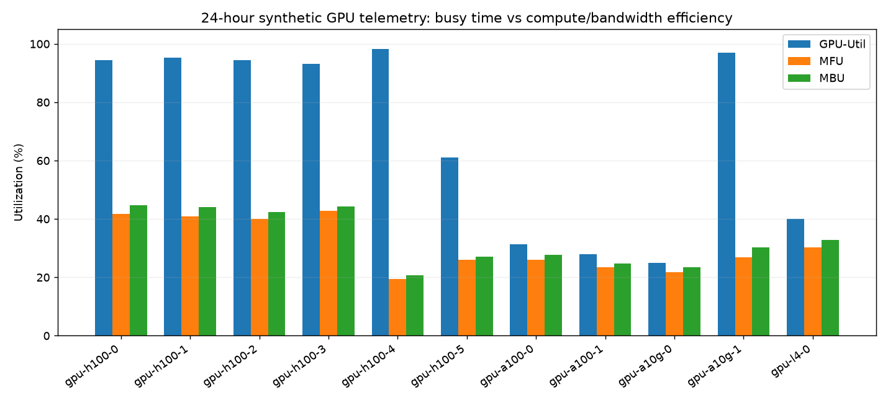

# Bonus — GPU FinOps

## 1. LiteLLM-style tracker (mock)

Đã nhận 15 request; chat bị chặn sau 10 request.
Chi phí chat $0.046050 ≤ cap $0.05; eval $0.000260.
Budget check/update được khóa để xử lý đồng thời; request bị chặn không tính phí. Backend mock, token ước tính theo ký tự; chưa gọi LiteLLM/provider thật. Spend ở RAM một process, không phải ledger production.

Evidence: [tracker.json](bonus/tracker.json).

## 2. Model chạy CPU

Trạng thái: **completed**.
Model `/tmp/gpufinops-tiny-gpt2`; median **292.90 output tok/s**, ước tính **$0.095/1M output token** với CPU $0.10/giờ.
M2 optimized = $1.126/1M input+output token. Hai mẫu số và chất lượng khác nhau, không thể kết luận model local rẻ hơn/tốt hơn API từ phép so sánh này.
Warm-up một lần, đo 5 lần; loại thời gian tải/load khỏi throughput. Tiny GPT-2 chỉ kiểm tra cơ chế, không phải model trả lời chất lượng production.

| Lần | Output token | Giây | Tok/s | USD/1M output token |
|---|---:|---:|---:|---:|
| 1 | 64 | 0.2185 | 292.90 | 0.095 |
| 2 | 64 | 0.2238 | 285.96 | 0.097 |
| 3 | 64 | 0.2122 | 301.56 | 0.092 |
| 4 | 64 | 0.2215 | 288.92 | 0.096 |
| 5 | 64 | 0.2143 | 298.60 | 0.093 |

Evidence: [local_model.json](bonus/local_model.json).

## 3. Prometheus + Grafana

Trạng thái kiểm tra stack: **completed**. Exporter xuất GPU-Util, MFU, MBU, công suất và proxy chi phí capacity cho 11 GPU.
HTTP exporter hoạt động; Prometheus scrape UP và query trả về 11 GPU; Grafana database/datasource OK, dashboard provisioned 5 panel.
Grafana runtime: 11.6.0. Dữ liệu Grafana/Prometheus giữ trong `.bonus-state/` của workspace; image IDs: [docker_image_ids.txt](bonus/docker_image_ids.txt).
Dashboard: http://localhost:3000/d/lab25-gpu-finops (admin/admin cho lab). Prometheus: http://localhost:9090.
Telemetry là trung bình của 24 giờ synthetic; `(1-MFU) × giá/giờ` là proxy capacity FLOPs, không phải mức lãng phí thu hồi được. Không cộng số này vào tiết kiệm M5.



Evidence: [stack_check.json](bonus/stack_check.json), [metrics](bonus/prometheus_metrics.txt).

## Tái chạy

```bash
.venv/bin/python bonus/run_all.py
docker compose -p gpufinops-bonus -f bonus/docker/docker-compose.yml up -d
.venv/bin/python bonus/run_all.py --stack --skip-model
docker compose -p gpufinops-bonus -f bonus/docker/docker-compose.yml down
```

Phiên bản Python đã chạy: [python_environment.txt](bonus/python_environment.txt). Dependencies model và thao tác Docker: xem README của từng bonus. Chi phí CPU là giá giả định, còn throughput là phép đo trên máy hiện tại.
